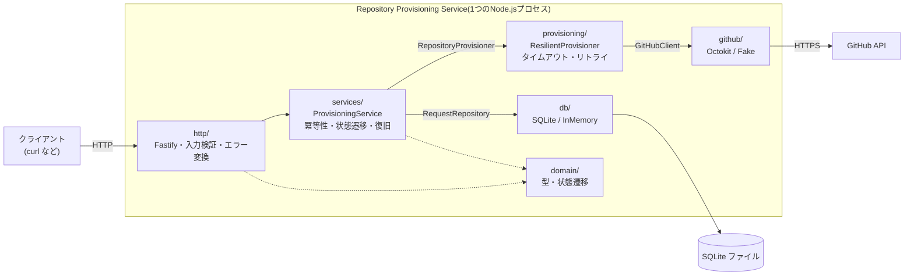
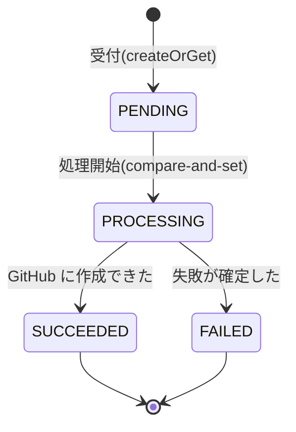

# アーキテクチャ設計書

判断の理由は [ADR](adr/README.md)。ここでは構成を説明する。

## 1. 全体構成



実線の矢印は「呼び出し」、`RequestRepository` などの名前は**インターフェース(ポート)**。
サービスは具体的な実装(SQLite か InMemory か)を知らない。

## 2. 責務(誰が何をするか)

| 責務                     | 置き場所                                                                   | やること / やらないこと                                                                                              |
| ------------------------ | -------------------------------------------------------------------------- | -------------------------------------------------------------------------------------------------------------------- |
| HTTP API                 | `http/`                                                                    | ルーティング、ヘッダ・ボディの読み取り、レスポンスの形(`RequestResource`)、エラー→HTTP変換。**ビジネス判断はしない** |
| 入力値検証               | `schemas/`                                                                 | Zod スキーマ。型の導出(`z.infer`)。環境変数の検証                                                                    |
| アプリケーションロジック | `services/`                                                                | ユースケース。冪等性、状態遷移の順序、復旧。HTTP・SQL・GitHub の詳細を知らない                                       |
| ドメインロジック         | `domain/`                                                                  | 型、状態遷移の規則、要求内容のハッシュ。外部ライブラリに依存しない                                                   |
| GitHub との通信          | `github/`(クライアント)、`provisioning/`(タイムアウト・リトライ・重複防止) | `GitHubClient` は1回のAPI呼び出し。`ResilientProvisioner` はそれを「確実に」行う方針                                 |
| DBアクセス               | `db/`                                                                      | SQL は `sqlite-request-repository.ts` と `migrations.ts` の中だけ                                                    |
| ログ                     | `logging/`                                                                 | ロガー生成、秘密のマスク                                                                                             |
| エラーハンドリング       | `errors/`, `http/errors.ts`, `github/classify.ts`                          | カタログ、分類、変換                                                                                                 |
| 横断                     | `shared/`, `async/`                                                        | `Result`, `Page`, `Clock`, `IdGenerator`, `retry`, `withTimeout`                                                     |
| 組み立て                 | `composition.ts`, `main.ts`                                                | Composition Root(`new` を書くのはここだけ)                                                                           |

## 3. 主要なインターフェース(ポート)

```ts
// db/request-repository.ts
interface RequestRepository {
  createOrGet(input): Promise<{ request; created }>; // 冪等な受付
  findById(id);
  list(filter);
  transition(id, from, target): Promise<Request | null>; // compare-and-set
  findStale(statuses, olderThan);
}

// github/types.ts
interface GitHubClient {
  createRepository(spec, opts?);
  getRepository(owner, name, opts?);
  replaceTopics(owner, name, topics, opts?);
  getAuthenticatedLogin(opts?);
}

// provisioning/types.ts
interface RepositoryProvisioner {
  provision(spec, ctx): Promise<Result<ProvisionSuccess, ProvisionFailure>>;
  reconcile(spec, ctx): Promise<Result<ProvisionSuccess, ProvisionFailure>>;
}
```

## 4. 状態遷移



それ以外の遷移(例: `SUCCEEDED→FAILED`、`PENDING→SUCCEEDED`)は `InvalidTransitionError`。DB の `CHECK` 制約も、状態と各列の整合を守る。

## 5. 依存関係の向き(守るルール)

```
http ──▶ services ──▶ (db/request-repository の型)  (provisioning/types の型)
                              ▲                              ▲
                  db/sqlite-... が実装            provisioning/resilient-... が実装 ──▶ (github/types の型)
                                                                                      ▲
                                                                  github/octokit-client, fake が実装
composition.ts が、上のすべての「実装」を new して配線する
```

- `domain/` ← だれからでも import してよい(最も内側)
- `services/` は `http/` を import しない。`db/`・`github/` の**実装クラス**を import しない
- テスト用の差し替え(Fake / InMemory / スタブ)は、**同じインターフェースを満たす**だけで動く

## 6. 並行性と整合性

- 1プロセス・シングルスレッド(Node.js)。ただし `await` のたびに他のリクエストが割り込むので、**「確認してから更新」は必ず原子的に**する
  - 受付: SQLite のトランザクション + UNIQUE 制約
  - 状態更新: `UPDATE ... WHERE status = ?`(compare-and-set)
- better-sqlite3 は同期APIなので、1回のDB操作の最中に他の処理が割り込むことはない

## 7. シーケンス図

[シーケンス図集](sequence-diagrams.md)(正常 / 入力検証エラー / GitHub認証エラー / タイムアウト / リトライ / 重複要求 / DB保存失敗 / 中断からの復旧)

## 8. ディレクトリ構成(`reference/src/` = `starter/src/`)

```
src/
├── main.ts                    起動・終了処理
├── composition.ts             Composition Root(DIの組み立て)         [ex06]
├── domain/
│   ├── request.ts             型(状態ごとの判別可能Union)             [ex01]
│   ├── state-machine.ts       状態遷移の規則                          [ex01]
│   └── request-hash.ts        要求内容のハッシュ(冪等性の内容比較)
├── shared/                    Result / Page [ex02]、Clock、IdGenerator
├── async/                     timeout・retry・concurrency [ex03]、sleep
├── schemas/                   Zod スキーマ・環境変数                   [ex04]
├── http/                      Fastify アプリ・エラー変換・OpenAPI       [ex05]
├── services/                  ProvisioningService                     [ex06, ex10]
├── db/                        Repositoryインターフェース・InMemory [ex06]・SQLite [ex09]
├── github/                    GitHubClient(Octokit/Fake)・エラー分類   [ex08]
├── provisioning/              ResilientProvisioner(リトライ・曖昧な失敗) [ex08]
├── errors/                    エラーカタログ・AppError
└── logging/                   ロガー・秘密のマスク                      [ex08]
```

`[exNN]` は、その課題で学習者が実装する箇所(それ以外は最初から用意されている)。
