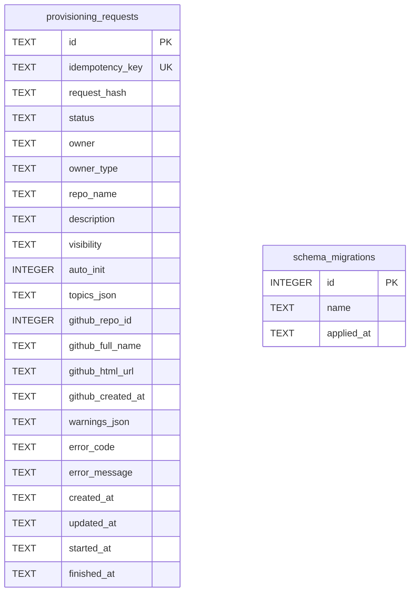

# DB設計書

SQLite(ローカルファイル。既定 `./data/app.sqlite`、`.gitignore` 済み)。判断の理由は [ADR-0010](adr/0010-sqlite-schema.md)。
スキーマの実体: [`reference/src/db/migrations.ts`](../reference/src/db/migrations.ts)(課題09で自分で書く)。

## テーブル

### `provisioning_requests`

| 列                                                           | 型          | NULL | 説明                                                                         |
| ------------------------------------------------------------ | ----------- | ---- | ---------------------------------------------------------------------------- |
| `id`                                                         | TEXT PK     | NO   | 作成要求のID(UUID)                                                           |
| `idempotency_key`                                            | TEXT UNIQUE | NO   | クライアントが送った `Idempotency-Key`                                       |
| `request_hash`                                               | TEXT        | NO   | 要求内容の SHA-256(同じキーで内容が違う要求の検出)                           |
| `status`                                                     | TEXT        | NO   | `PENDING` / `PROCESSING` / `SUCCEEDED` / `FAILED`(CHECK)                     |
| `owner` / `owner_type` / `repo_name`                         | TEXT        | NO   | 作成するリポジトリ(`owner_type` は CHECK)                                    |
| `description`                                                | TEXT        | YES  |                                                                              |
| `visibility`                                                 | TEXT        | NO   | `public` / `private`(CHECK)                                                  |
| `auto_init`                                                  | INTEGER     | NO   | 0 / 1(CHECK)                                                                 |
| `topics_json`                                                | TEXT        | NO   | JSON配列(`json_valid` で検査)                                                |
| `github_repo_id`                                             | INTEGER     | YES  | `SUCCEEDED` のとき必須                                                       |
| `github_full_name` / `github_html_url` / `github_created_at` | TEXT        | YES  | 同上。`github_created_at` は復旧時の「今回の処理で作られたか」の判定にも使う |
| `warnings_json`                                              | TEXT        | NO   | JSON配列。既定 `[]`                                                          |
| `error_code` / `error_message`                               | TEXT        | YES  | `FAILED` のとき必須(**定型メッセージのみ**。内部の詳細は保存しない)          |
| `created_at` / `updated_at`                                  | TEXT        | NO   | ISO 8601 UTC                                                                 |
| `started_at`                                                 | TEXT        | YES  | `PROCESSING` に入った時刻。`PENDING` のときだけ NULL                         |
| `finished_at`                                                | TEXT        | YES  | `SUCCEEDED`/`FAILED` のときだけ非NULL                                        |

テーブルは `STRICT`(列の型を厳密に検査)。

### 状態と列の整合(テーブルの `CHECK` 制約)

| status     | github_repo_id | error_code | started_at | finished_at |
| ---------- | -------------- | ---------- | ---------- | ----------- |
| PENDING    | NULL           | NULL       | NULL       | NULL        |
| PROCESSING | NULL           | NULL       | 必須       | NULL        |
| SUCCEEDED  | **必須**       | NULL       | 必須       | 必須        |
| FAILED     | NULL           | **必須**   | 必須       | 必須        |

(制約の式: `(status='SUCCEEDED') = (github_repo_id IS NOT NULL)` のように「条件 ⇔ 列の有無」で書く)

### インデックス

| 名前                           | 内容                                                                                               | 目的                                                                                |
| ------------------------------ | -------------------------------------------------------------------------------------------------- | ----------------------------------------------------------------------------------- |
| (自動)`idempotency_key` UNIQUE |                                                                                                    | 冪等性。重複した受付を DB が拒否                                                    |
| `idx_requests_created`         | `(created_at DESC, id DESC)`                                                                       | 一覧(新しい順 + ページング)                                                         |
| `idx_requests_status_updated`  | `(status, updated_at)`                                                                             | 復旧(`findStale`: 状態と古さで検索)                                                 |
| `uq_requests_in_flight_repo`   | UNIQUE `(owner COLLATE NOCASE, repo_name COLLATE NOCASE) WHERE status IN ('PENDING','PROCESSING')` | **部分ユニーク**: 同じリポジトリへの処理中の要求を1件に制限。終了すれば再挑戦できる |

### `schema_migrations`

| 列                | 説明                 |
| ----------------- | -------------------- |
| `id` INTEGER PK   | マイグレーション番号 |
| `name` TEXT       | 名前                 |
| `applied_at` TEXT | 適用日時             |

## 接続設定(`openDatabase`)

| PRAGMA         | 値     | 理由                                       |
| -------------- | ------ | ------------------------------------------ |
| `journal_mode` | `WAL`  | 読み取りと書き込みが互いをブロックしにくい |
| `foreign_keys` | `ON`   | 将来の外部キーのため(SQLiteは既定で無効)   |
| `busy_timeout` | `5000` | ロック競合時に即エラーにせず5秒待つ        |

## トランザクション

| 操作             | 範囲                     | 理由                                                                                 |
| ---------------- | ------------------------ | ------------------------------------------------------------------------------------ |
| `createOrGet`    | SELECT(既存確認)+ INSERT | 確認と挿入の間に別の処理が割り込まない。それでも競合した場合は UNIQUE 制約が拒否する |
| `transition`     | UPDATE + SELECT          | 更新結果を同じ時点で読み戻す                                                         |
| マイグレーション | 1件ごと                  | 途中で失敗したら、そのマイグレーションは丸ごと取り消され、履歴にも残らない           |

## クエリのルール

- SQL に値を埋め込まない。**必ず `?` のバインド変数**(SQLインジェクション対策。`list` の `LIMIT ? OFFSET ?` も同様)
- 一覧のソートは `created_at DESC, id DESC`(同時刻でも順序が一定)
- DBの障害は `PersistenceError` に包んで投げる(SQLの詳細は `cause` に。HTTPでは 500 の定型エラー)

## ER図

(テーブルは1つだけ。リポジトリ情報・エラー情報は同じ行に持つ=1つの作成要求に1つの結果。履歴(試行ごとの記録)が必要になったら `attempts` テーブルを追加する — 発展課題)
