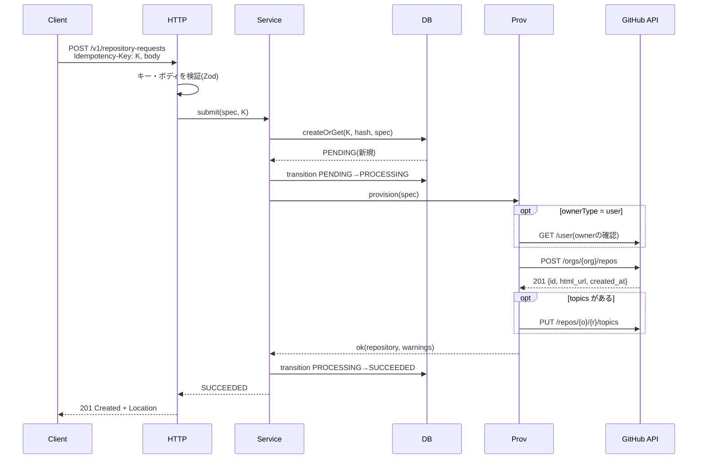
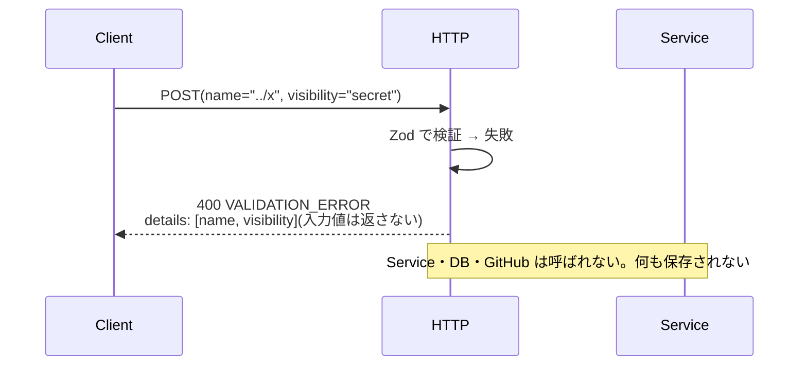
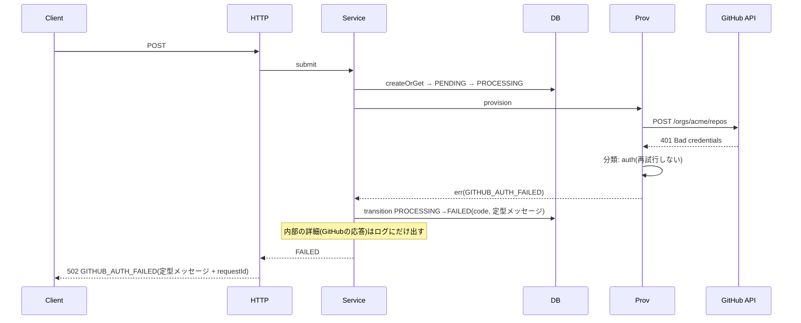
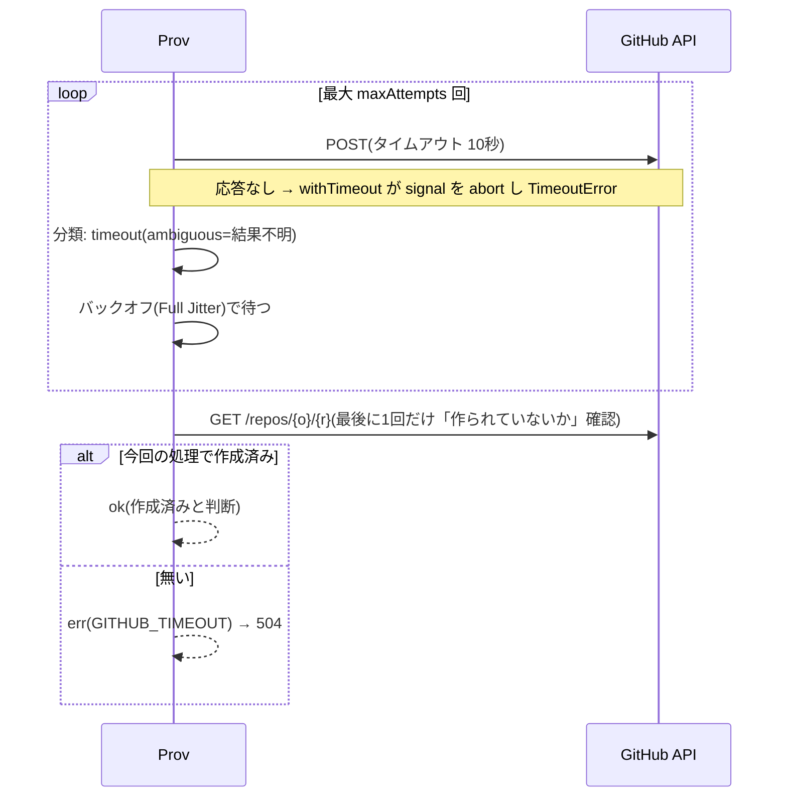
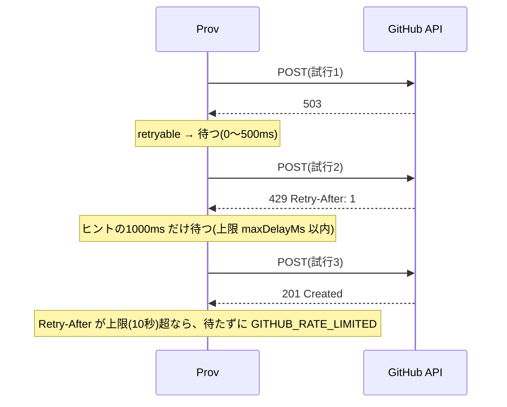
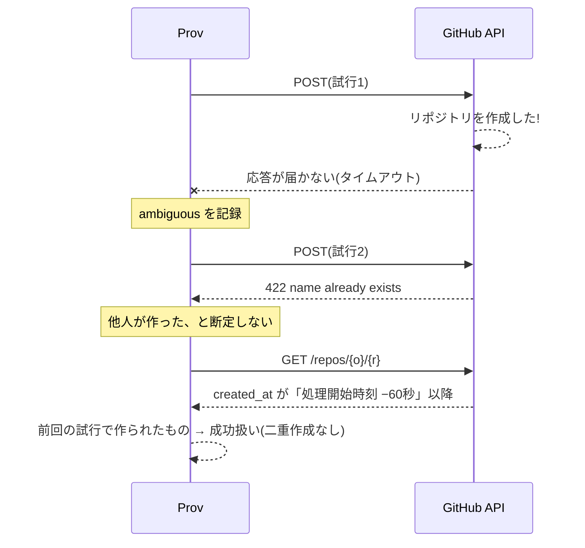
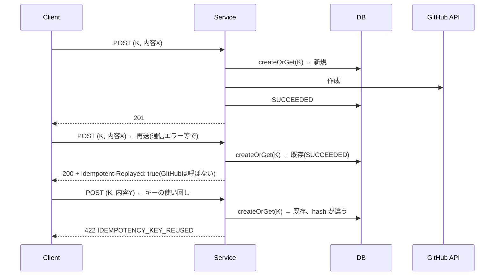
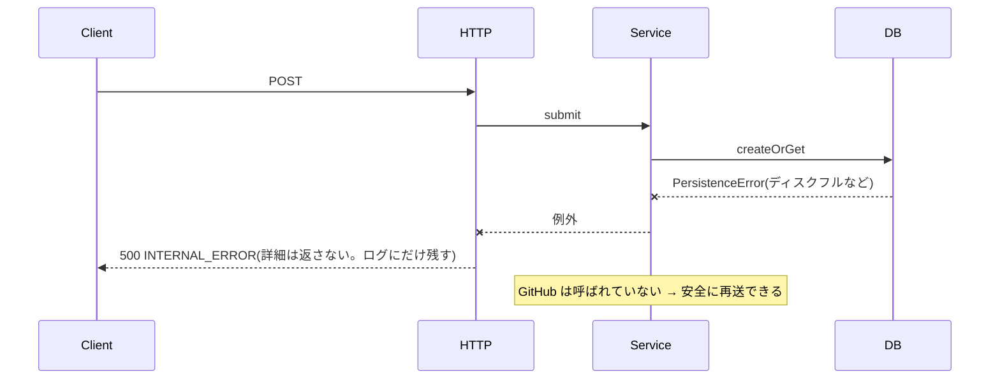
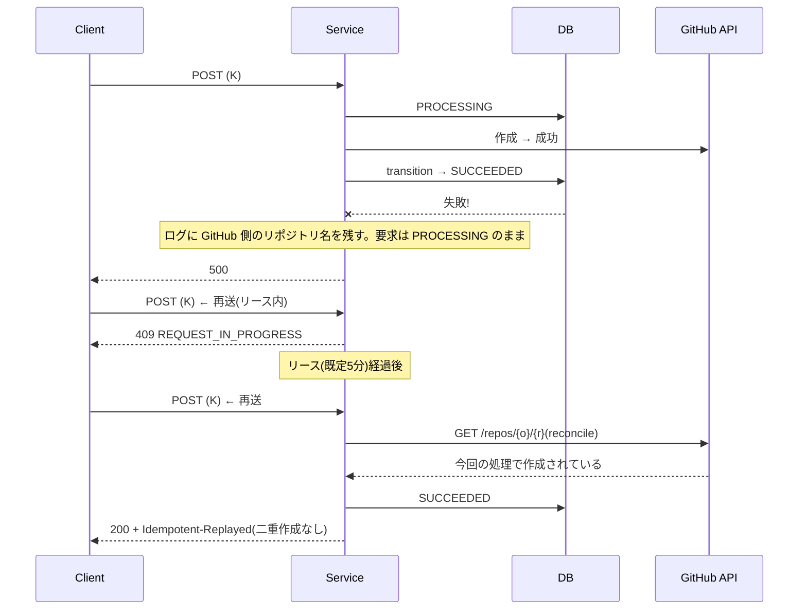
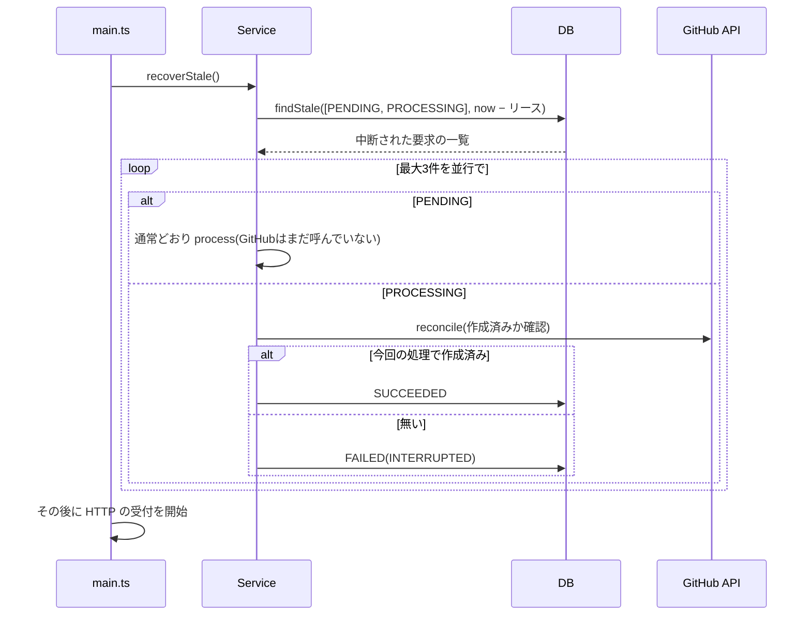

# シーケンス図集

登場人物: `Client`(クライアント)、`HTTP`(`http/`)、`Service`(`ProvisioningService`)、`DB`(`RequestRepository`)、`Prov`(`ResilientProvisioner`)、`GH`(GitHub API)。
図は GitHub 上でそのまま表示される(Mermaid)。各図の下に「対応するテスト」を示す。

## 1. 正常なリポジトリ作成

テスト: `reference/test/http/api.test.ts`「201: 作成でき…」、`exercises/tests/ex10-idempotency.test.ts`

## 2. 入力値検証エラー

テスト: `exercises/tests/ex05-api.test.ts`「入力の検証(サービスは呼ばれない)」

## 3. GitHub API 認証エラー(再試行しない)

テスト: `exercises/tests/ex08-provisioner.test.ts`「失敗(再試行しない)」、`api.test.ts`「GitHub の失敗がどう見えるか」

## 4. GitHub API タイムアウト

テスト: `ex08-provisioner.test.ts`「応答しない相手には、タイムアウトして GITHUB_TIMEOUT」「曖昧な失敗が続いて諦めた場合…」

## 5. リトライ(一時障害・レート制限)

テスト: `ex08-provisioner.test.ts`「リトライ」、`ex03-retry.test.ts`

### 5-2. 「結果が分からない失敗」のあとの再試行(重複作成の防止)

テスト: `ex08-provisioner.test.ts`「タイムアウトしたが実は作成済み…」「以前から存在した同名リポジトリは…」

## 6. Idempotency-Key による重複要求

同時に2つ届いた場合: 先に `PENDING→PROCESSING` にできた1つだけが実行し、もう一方は 409 `REQUEST_IN_PROGRESS`(`Retry-After: 5`)。
テスト: `ex10-idempotency.test.ts`「submit: 冪等性」

## 7. DB 保存失敗

### 7-1. 最初の保存に失敗(まだ何もしていない)

### 7-2. GitHub では作成できたが、結果の保存に失敗(最も危険)

テスト: `ex10-idempotency.test.ts`「障害: GitHubでは作成できたが、DBに結果を保存できなかった」、`api.test.ts`「SQLite への保存失敗」

## 8. プロセスが落ちた後の復旧(起動時)

テスト: `ex10-idempotency.test.ts`「復旧(recoverStale)」
